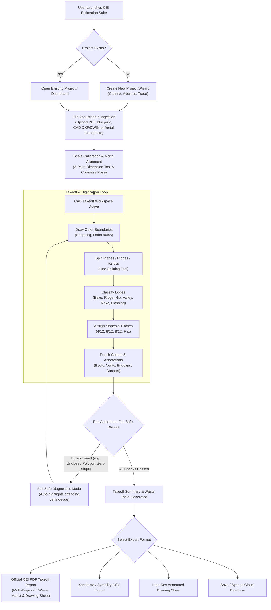

# User Flows & Interactive Journeys
**Application:** CEI Estimation LLC — Precision CAD Takeoff Platform  
**Target Roles:** Estimator, CAD Technician, Quality Control (QC) Lead, Project Manager  

---

## 1. Flow Overview Diagram

---

## 2. Detailed Step-by-Step Journeys

### User Flow 1: New Project Ingestion & Scale Calibration
1. **User lands on Dashboard**: Views list of current projects with status filters (New, In Progress, Inspected, Completed).
2. **Click "+ New Project"**:
   - Enters Project Name (e.g. *"742 Evergreen Terrace Residential Re-Roof"*).
   - Enters Claim / Job # (e.g. *"CLM-2026-98124"*).
   - Enters Site Address (e.g. *"Springfield, OR"*).
   - Selects Primary Trade: `Roofing`, `RoofScopeX`, `Siding`, `Gutter`, `Concrete`, `Insulation`, or `Paint`.
   - Enters Primary Pitch (e.g. `6/12`).
3. **Uploads Plan / Blueprint**:
   - Drag-and-drops PDF (multi-page blueprint) or CAD DXF file.
   - For multi-page PDF, preview thumbnails and select the Roof / Elevation plan sheet.
4. **Scale Calibration Prompt**:
   - The system instructs: *"Click two points along a known dimension line (e.g., ridge or wall dimension) to calibrate scale."*
   - User clicks Point A and Point B.
   - User enters real-world measurement: e.g. `48' 0"` or `48 ft`.
   - The system calculates Pixels-Per-Foot (`PPF = EuclideanDistance(P1, P2) / 48`).
   - Visual scale ruler and badge update instantly in the bottom status bar: `1" = 10' (Scale: 12.5 px/ft)`.

---

### User Flow 2: Roofing & Cladding Takeoff Digitization
1. **Draw Perimeter Boundary**:
   - Selects `Boundary Tool` (hotkey `B` or Ribbon button).
   - Clicks around exterior perimeter. Magnetic snap snaps to 90°/45° or existing vertices.
   - Double-click or click initial vertex to close the loop.
   - Closed polygon is filled with semi-transparent tint and calculated footprint SF.
2. **Subdivide Planes with Ridge / Valley Tool**:
   - Selects `Ridge Tool` (hotkey `R`). Draws main ridge line from peak to peak.
   - Selects `Valley Tool` (hotkey `V`). Draws valleys intersecting the eave.
   - Selects `Hip Tool` (hotkey `H`).
   - The polygon auto-partitions into individual roof facets (Plane 1, Plane 2, Plane 3, etc.).
3. **Assign Pitch & Edge Types**:
   - User clicks a plane and selects pitch from quick radial dial or dropdown (e.g. `6/12`).
   - True surface area automatically recalculates with slope factor:
     $$\text{True SF} = \text{Footprint SF} \times \sqrt{1 + (6/12)^2} = \text{Footprint SF} \times 1.118$$
   - Edge classification palette color-codes edges:
     - **Eave**: Emerald Green (`#10B981`)
     - **Ridge**: Crimson Red (`#EF4444`)
     - **Hip**: Purple (`#8B5CF6`)
     - **Valley**: Blue (`#3B82F6`)
     - **Rake**: Amber / Orange (`#F59E0B`)
     - **Step Flashing**: Cyan (`#06B6D4`)
     - **Headwall Flashing**: Teal (`#14B8A6`)
     - **Parapet / Coping**: Charcoal (`#4B5563`)
4. **Punch Counts & Accessories**:
   - Selects `Count Tool` (hotkey `C`).
   - Selects marker type: `Pipe Boot`, `Box Vent`, `Ridge Vent LF`, `Chimney Flash`.
   - Clicks on drawing to stamp items. The right sidebar increments item totals in real time.

---

### User Flow 3: Automated Fail-Safe Validation
1. Prior to generating a formal quote or PDF report, the user clicks **"Verify Takeoff"** or **"Generate Report"**.
2. The Validation Engine runs 5 simultaneous checks:
   - **Missing Polygon Check:** Checks if any drawn lines form an open loop without assigned area.
   - **Negative Area Check:** Validates that cutouts/deductions do not exceed host polygon boundaries.
   - **Zero Slope Drainage Check:** Checks if any valley or eave is tagged on a horizontal plane without drainage slope.
   - **Scale Drift Check:** Verifies that calibrated scale matches standard architectural ratios.
   - **Notes Acknowledgment:** Verifies that adjuster/client scope notes were reviewed.
3. If issues exist, a **Diagnostic Fail-Safe Modal** appears with "Zoom to Error" buttons.
4. Once verified, the green **"Audit Passed — Ready for Export"** badge illuminates.

---

### User Flow 4: Report Generation & Multi-Page Export
1. User clicks **"Export Report"** -> **"CEI Official PDF"**.
2. Multi-page report preview renders in real time:
   - **Page 1 (Cover & Executive Summary):** CEI Estimation LLC branding, Project details, Total Squares, Primary Pitch, Waste Matrix (4% to 15% with recommended 10% highlighted).
   - **Page 2 (Detailed Quantities & Edge Breakdown):** Table of LF for Eave, Ridge, Hip, Valley, Rake, Flashings; Material SQ totals; Slope breakdown (Flat, Low, Standard, Steep).
   - **Page 3 (Annotated Takeoff Blueprint Sheet):** Canvas vector drawing converted to high-DPI sheet with Color-coded Edge Legend, Compass Rose, and Scale Bar.
3. User selects action:
   - **Download PDF**: Direct PDF file generation via jsPDF / browser print engine.
   - **Export CSV**: For Xactimate / Symbility import.
   - **Sync to Cloud**: Saves snapshot to project database.

